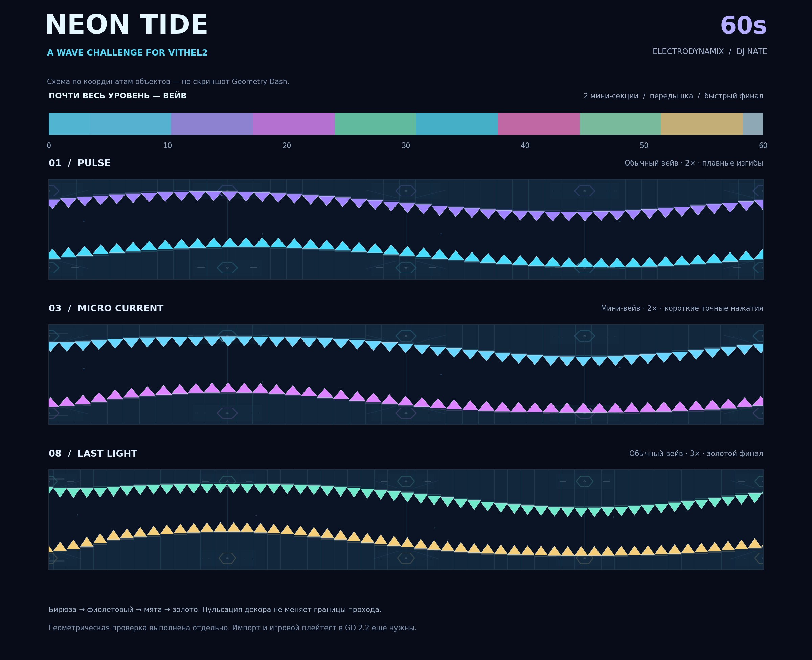

# Neon Tide

Челлендж для Vithel2: около минуты, почти целиком вейв, две мини-секции, неоновый декор. Музыка — встроенный трек DJ-Nate — Electrodynamix.

## Скачать

- [Neon Tide (.gdlvl)](levels/neon-tide/Neon_Tide.gdlvl)
- [Neon Tide (.gmd)](levels/neon-tide/Neon_Tide.gmd)
- [Полный архив с разбором и инструкцией](levels/neon-tide/Neon_Tide_pack.zip)
- [Разбор старого уровня и инструкция по импорту](levels/neon-tide/README_RU.md)

На странице файла нажми **Download raw file** для скачивания. Для импорта нужен совместимый мод или инструмент. Формат и модельная траектория проверены; игровой плейтест в Geometry Dash ещё не выполнен.

